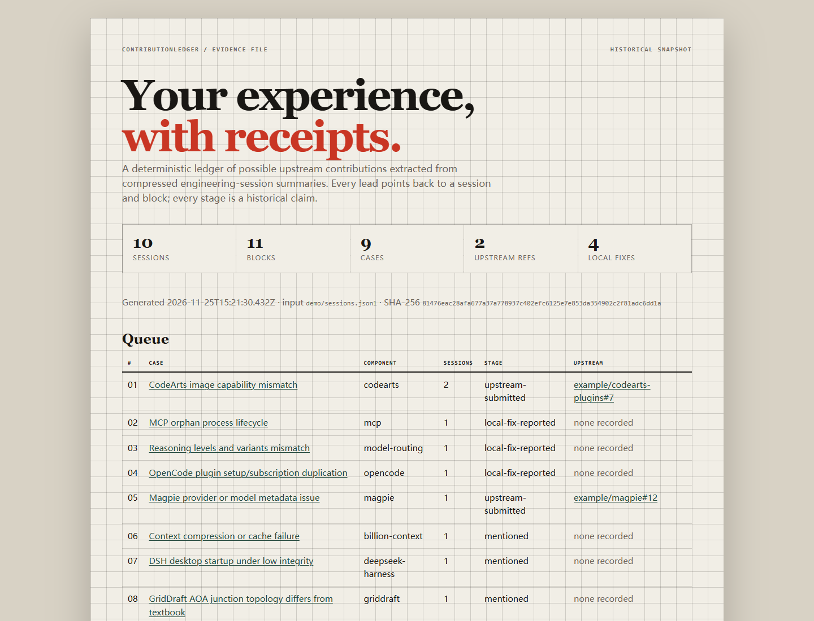

# ContributionLedger

English | [简体中文](README.zh-CN.md) | [日本語](README.ja.md) | [한국어](README.ko.md) | [Español](README.es.md)

**Your AI debugging history is useful. Turn it into evidence you can actually reuse.**

ContributionLedger reads compressed engineering-session summaries and gives you:

- **A memory that survives the chat.** Find the last time you hit the same error, and what fixed it.
- **Issue and PR evidence.** Every lead points to a session and block, with the reported stage attached.
- **A reusable track record.** Turn a solved problem into a case brief, an issue draft, or a contribution write-up.
- **No upload.** Offline, deterministic, no LLM calls, no database, no telemetry.

It is not an automatic issue generator. It produces leads for a human to reproduce, verify, and discuss with maintainers.



## Try it in 60 seconds

The repository ships with a synthetic inventory. No local data is read in demo mode.

```bash
git clone https://github.com/y-yaoyyy/contribution-ledger.git
cd contribution-ledger
node bin/contributionledger.mjs --demo --out ./contributionledger-demo
```

Open `contributionledger-demo/report.html` in a browser. You get a queue of cases, an evidence table, and one case brief per lead.

## Use your own sessions

If you use billion-context, export a summary-only inventory first:

```bash
node scripts/export-billion-context.mjs --out sessions.jsonl
node bin/contributionledger.mjs --input sessions.jsonl --out ./contributionledger-out
```

The exporter asks the local billion-context API for session summaries and block topics only. It does not request direct messages or compressed originals. See [docs/export-billion-context.md](docs/export-billion-context.md).

Already have JSONL? The format is one object per line:

```json
{
  "id": "session-123",
  "title": "CodeArts image capability",
  "blockDetails": [
    {
      "topic": "Image support",
      "summary": "The model was documented as text-only, but the kernel sent a real image."
    }
  ]
}
```

`blocks` is accepted as an alias for `blockDetails`. See [docs/input-format.md](docs/input-format.md) and [schema/inventory.schema.json](schema/inventory.schema.json).

## What you get

```text
contributionledger-out/
  report.md              human-readable queue and evidence
  report.html            self-contained visual report
  cases.json             structured cases for further tooling
  briefs/<case>.md       one issue-ready brief per case
```

A case contains:

- component and symptom
- distinct sessions where the symptom appeared
- reported stage (`mentioned`, `diagnosed`, `local-fix-reported`, `upstream-submitted`, `duplicate-reported`, `merged-reported`)
- GitHub issue/PR references found in the text
- contradictions between earlier and later conclusions
- privacy flags
- a next manual action

## Why not just read old chats?

Long-running agent sessions contain useful evidence, but it is scattered across compressed blocks. Copying summaries into a public issue is noisy and can leak private data. ContributionLedger extracts only the reproducible shape, and keeps the raw summary out by default.

| Common approach | ContributionLedger |
|---|---|
| Search one chat at a time | Groups the same symptom across sessions |
| Trust the latest summary | Keeps earlier claims and contradictions visible |
| Paste a whole transcript | Points to session/block references |
| Treat “opened a PR” as current status | Marks it as a historical claim |
| Require a hosted account | Runs offline on a JSONL file |

## Custom rules

The ten built-in rules cover the kinds of problems this project grew out of: CodeArts image capability, OpenCode plugin lifecycle, MCP process lifecycle, reasoning metadata, context compression, DSH startup, GridDraft AOA topology, Word report structure, subtitle coverage, and Magpie provider metadata.

For another stack, add a small declarative rule file:

```json
{
  "rules": [
    {
      "id": "my-stack-cache-key",
      "component": "my-stack",
      "symptom": "cache-key-collision",
      "title": "Cache key collision after upgrade",
      "all": ["my-stack", "cache"],
      "any": ["collision", "stale key"],
      "none": ["fixed upstream"]
    }
  ]
}
```

```bash
node bin/contributionledger.mjs --input sessions.jsonl --rules rules.json --out ./ledger
# Replace the built-in rules instead of extending them:
node bin/contributionledger.mjs --input sessions.jsonl --rules rules.json --rules-only --out ./ledger
```

Rules can only declare text that must all/any/none match. They cannot execute code. A custom rule with the same `id` as a built-in rule replaces it. See [docs/rules.md](docs/rules.md) and [schema/rules.schema.json](schema/rules.schema.json).

## Case briefs

`briefs/<case>.md` is the handoff from “I remember something” to “I can verify this”:

- evidence table with session and block references
- optional redacted excerpts, only with `--excerpts`
- upstream references and their recorded stages
- contradictions to resolve
- an issue draft with environment placeholders
- a pre-post checklist

See [docs/case-to-issue.md](docs/case-to-issue.md).

## Privacy

- The default report does **not** include raw summary text.
- Common API keys, GitHub/Slack tokens, auth headers, private keys, base64 image payloads, and password assignments are detected.
- Detected values are redacted from retained topics and from `--excerpts`.
- Real session data should not be committed to a public repository. Use the synthetic fixture or demo.
- No scanner is perfect. Review `cases.json` and any excerpt before sharing.

## Development

```bash
npm test
npm run check
npm run demo
```

The test suite uses only `node:test` and the Node standard library. The demo inventory is synthetic.

## Limitations

- Rules are intentionally narrow. A missed case is preferable to a confident false report.
- The tool works from the compressed inventory you provide, not full transcripts or tool logs.
- It cannot decide whether a reported upstream issue is still open.
- A reported stage is historical. Reproduce before posting.
- It does not file issues or open pull requests.

## License

MIT. See [LICENSE](LICENSE).