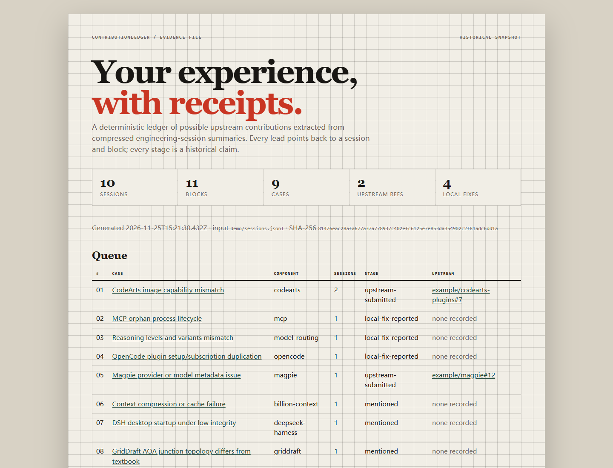

# ContributionLedger

[English](README.md) | 简体中文 | [日本語](README.ja.md) | [한국어](README.ko.md) | [Español](README.es.md)

**你用 AI 写代码留下的经验，不该随着聊天记录一起消失。**

ContributionLedger 读取压缩后的工程会话摘要，帮你得到：

- **一个不会随会话消失的记忆。** 下次遇到同一个错误，能找回上次的解法。
- **issue / PR 的证据。** 每条线索都能回溯到会话与压缩块，并标明当时记录到哪一步。
- **可复用的经验账本。** 把踩过的坑整理成案例 brief、issue 草稿或贡献记录。
- **不上传。** 离线、确定性运行，不调用 LLM，不使用数据库，不上报遥测。

它不是自动提 issue 的机器。它只生成线索，由人工复现、验证，再与维护者沟通。



## 60 秒试用

仓库自带合成 demo，不会读取你的真实会话：

```bash
git clone https://github.com/y-yaoyyy/contribution-ledger.git
cd contribution-ledger
node bin/contributionledger.mjs --demo --out ./contributionledger-demo
```

用浏览器打开 `contributionledger-demo/report.html`，你会看到案例队列、证据表和每个案例的 brief。

## 接入自己的会话

如果你使用 billion-context，先导出只含摘要的清单：

```bash
node scripts/export-billion-context.mjs --out sessions.jsonl
node bin/contributionledger.mjs --input sessions.jsonl --out ./contributionledger-out
```

导出脚本只向本地 billion-context API 请求会话摘要和块 topic，不请求直接消息或压缩原文。详见 [docs/export-billion-context.md](docs/export-billion-context.md)。

已有 JSONL？每行一个对象：

```json
{
  "id": "session-123",
  "title": "CodeArts 图片能力",
  "blockDetails": [
    {
      "topic": "图片支持",
      "summary": "模型文档写的是纯文本，但内核实际发送了真实图片。"
    }
  ]
}
```

`blocks` 可以作为 `blockDetails` 的别名。详见 [docs/input-format.md](docs/input-format.md) 和 [schema/inventory.schema.json](schema/inventory.schema.json)。

## 输出

```text
contributionledger-out/
  report.md              人类可读的队列与证据
  report.html            自包含的视觉报告
  cases.json             供后续工具使用的结构化案例
  briefs/<case>.md       每个案例一份可整理的 issue brief
```

每个案例包含：

- 组件与症状
- 症状出现过的不同会话
- 会话中记录的阶段（提及、已诊断、已本地修复、已提交、重复、已合并）
- 文本中出现的 GitHub issue/PR 引用
- 前后结论之间的矛盾
- 隐私标记
- 下一步人工动作

## 为什么不能直接翻旧聊天？

长时间运行的 Agent 会话里有很多证据，但它们散落在压缩块中。把摘要直接贴进公开 issue 既吵，也可能泄露隐私。ContributionLedger 只提取可复现的骨架，默认不输出原始摘要。

| 常见做法 | ContributionLedger |
|---|---|
| 一次只翻一个会话 | 把同一症状跨会话聚合 |
| 相信最新一条摘要 | 保留早期结论与矛盾 |
| 粘贴整段聊天 | 只给 session/block 引用 |
| 把“提过 PR”当成当前状态 | 标成历史声明 |
| 必须登录托管服务 | 本地读 JSONL 即可 |

## 自定义规则

十条内置规则覆盖本项目提炼自的领域：CodeArts 图片能力、OpenCode 插件生命周期、MCP 进程生命周期、推理元数据、上下文压缩、DSH 启动、GridDraft AOA 拓扑、Word 报告结构、字幕覆盖率和 Magpie provider 元数据。

换一个技术栈时，可以写一个声明式规则文件：

```json
{
  "rules": [
    {
      "id": "my-stack-cache-key",
      "component": "my-stack",
      "symptom": "cache-key-collision",
      "title": "升级后缓存 key 冲突",
      "all": ["my-stack", "cache"],
      "any": ["collision", "stale key"],
      "none": ["fixed upstream"]
    }
  ]
}
```

```bash
node bin/contributionledger.mjs --input sessions.jsonl --rules rules.json --out ./ledger
# 替换而不是追加内置规则：
node bin/contributionledger.mjs --input sessions.jsonl --rules rules.json --rules-only --out ./ledger
```

规则只能声明 all/any/none 文本匹配，不能执行代码。自定义规则与内置规则同 `id` 时会覆盖内置规则。详见 [docs/rules.md](docs/rules.md) 和 [schema/rules.schema.json](schema/rules.schema.json)。

## 案例 brief

`briefs/<case>.md` 把“我记得好像有个问题”推进到“我可以验证”：

- 带 session/block 引用的证据表
- 仅在 `--excerpts` 时出现的脱敏摘录
- 上游引用与当时记录的阶段
- 需要解决的矛盾
- 带环境占位符的 issue 草稿
- 发布前 checklist

详见 [docs/case-to-issue.md](docs/case-to-issue.md)。

## 隐私

- 默认报告**不包含**原始摘要。
- 会检测常见 API key、GitHub/Slack token、认证头、私钥、base64 图片载荷和 password 赋值。
- 检测到的值会从保留的 topic 与 `--excerpts` 中脱敏。
- 真实会话数据不应提交到公开仓库，请使用合成 fixture 或 demo。
- 没有扫描器是完美的；分享 `cases.json` 或摘录前请先检查。

## 开发

```bash
npm test
npm run check
npm run demo
```

测试只使用 `node:test` 与 Node 标准库，demo 数据为合成数据。

## 局限

- 规则刻意保守。漏报一个案例，好过自信地误报。
- 只处理你提供的压缩清单，不读取完整聊天或工具日志。
- 无法判断上游 issue 当前是否仍然开放。
- 报告里的阶段是历史声明，发布前必须复现。
- 不会自动提 issue 或开 PR。

## License

MIT，见 [LICENSE](LICENSE)。